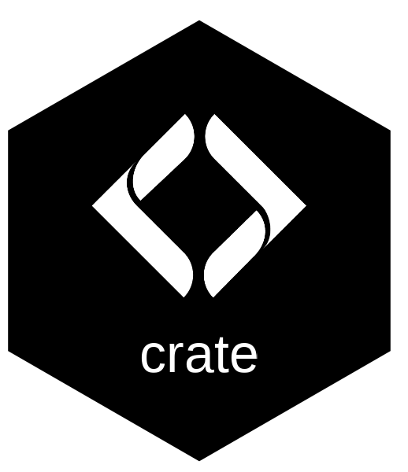

# crate 

<!-- badges: start -->
[](https://lifecycle.r-lib.org/articles/stages.html#experimental)
<!-- badges: end -->

> Canonical schemas for data that changes shape, and provenance receipts for what we build from it.

crate declares a canonical shape for each file or table it registers. It reads a registered file to that shape whichever known layout arrives, so when upstream changes the file's columns or layout, the fix is made once in crate and code downstream keeps working; data read some other way is held to the same shape. Its provenance receipt, one JSON file beside an output, records how the output was made and what came out, so a rebuild can be compared with its reference copy and judged identical, equivalent within a declared tolerance, or different, naming what differed.

## Installation

```r
pak::pak("NewGraphEnvironment/crate")
```

crate is under active development and its functions change between releases (see [NEWS](https://newgraphenvironment.github.io/crate/news/)). Pin a release for reproducible work: `pak::pak("NewGraphEnvironment/crate@vX.Y.Z")`.

## Example

[bcfishpass](https://github.com/smnorris/bcfishpass) reshaped `user_habitat_classification.csv` from long to wide on 2026-04-26. crate ships a small synthetic example of each shape, and one call reads either to the same columns:

```r
library(crate)

wide <- crt_ingest("bcfp", "user_habitat_classification",
  system.file("extdata/examples/bcfp/user_habitat_classification_wide.csv", package = "crate"))
long <- crt_ingest("bcfp", "user_habitat_classification",
  system.file("extdata/examples/bcfp/user_habitat_classification_long.csv", package = "crate"))
identical(names(wide), names(long))
#> [1] TRUE
```

One build was made twice from the same code, and its `km` column differed in the 11th decimal place because the database summed in another order. crate ships a synthetic copy of both builds with their receipts:

```r
wc <- system.file("extdata", "receipt", "examples", "worked_case", package = "crate")
crt_receipt_compare(file.path(wc, "build_1"), file.path(wc, "build_2"))
#> equivalent (receipts only)
#>   within result.parts[access_check.csv].bytes: 124 vs 128; table access_check agrees
#>   within result.parts[access_check.csv].sha256: "04994ff01cdee55d69fc410add51ad261ec4b33a751135fc224e97305823c3e2" vs "6801fb7bb092626441fd804d5ffbf8c4c05213ff18fa7c7ca524a9c2aa32f5e4"; table access_check agrees
#>   within result.summary[km_total]: 47.3767792597 vs 47.376779259805; within 1e-06
#>   record context.run: {"link_run_id":"20261104T181900Z-bulk"} vs {"link_run_id":"20261104T214400Z-bulk"}
#>   record context.time: "2026-11-04T18:22:05Z" vs "2026-11-04T21:47:31Z"
```

The file's bytes differ, but the receipt says the file holds the `access_check` table, whose fingerprint agrees under the declared `1e-9` tolerance on `km`, and `km_total` differs within its `1e-6`, so the builds are equivalent. The run identifiers and times are context, recorded and never part of an identity.

## Learn more

- [How reading works](https://newgraphenvironment.github.io/crate/articles/reading.html): what crate knows about, one call reading two shapes of a file, and what happens between the file and the returned table.
- [Provenance receipts](https://newgraphenvironment.github.io/crate/articles/receipt.html): the receipt contract, writing a receipt and comparing two builds.
- Function reference: [Ingest](https://newgraphenvironment.github.io/crate/reference/index.html#ingest), [Schemas](https://newgraphenvironment.github.io/crate/reference/index.html#schemas) and [Provenance receipts](https://newgraphenvironment.github.io/crate/reference/index.html#provenance-receipts).
- [Schemas](https://github.com/NewGraphEnvironment/crate/blob/main/inst/extdata/schemas/README.md): the schema format, and how to register a new file or table.
- [STAC field schemas](https://github.com/NewGraphEnvironment/crate/blob/main/pkgdown/assets/stac/README.md): JSON Schemas for custom fields a STAC item can list in `stac_extensions`, published with crate's website.

## Ecosystem

| Package | Role |
|---|---|
| **crate** | Canonical schemas for data that changes shape, and provenance receipts for outputs (this package) |
| [fresh](https://www.newgraphenvironment.com/fresh/) | Stream network modelling engine: segment, classify, cluster, aggregate |
| [link](https://www.newgraphenvironment.com/link/) | Intrinsic habitat models: develop, test and communicate |
| [wet](https://www.newgraphenvironment.com/wet/) | Stream flow and water temperature for BC's Freshwater Atlas |
| [flooded](https://www.newgraphenvironment.com/flooded/) | Delineate floodplain extents from DEMs and stream networks |
| [drift](https://www.newgraphenvironment.com/drift/) | Track land cover change within floodplains over time |
| [floodplains](https://www.newgraphenvironment.com/floodplains/) | Floodplain and land cover change modelling for BC watershed groups |
| [stac_floodplains_bc](https://www.newgraphenvironment.com/stac_floodplains_bc/) | STAC catalogue of floodplain land cover change in BC, 2017-2023, by watershed group |
| [cd](https://www.newgraphenvironment.com/cd/) | Climate departure analysis from ERA5-Land reanalysis |
| [fly](https://www.newgraphenvironment.com/fly/) | Estimate airphoto footprints and select photos that cover a study area |

## Citation

```r
citation("crate")
```

## License

MIT (see [`LICENSE.md`](https://github.com/NewGraphEnvironment/crate/blob/main/LICENSE.md)).
